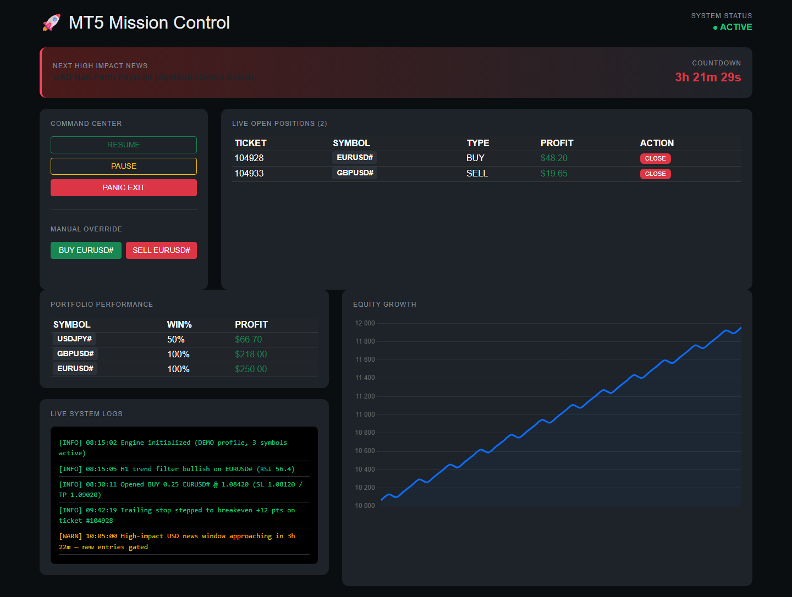
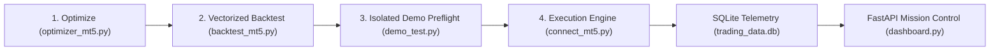

<div align="center">
  
  <h1>MetaTrader 5 Python Trading Suite</h1>
  <p>
    <strong>Algorithmic FX trading engine for MetaTrader 5 featuring multi-symbol portfolio execution, dynamic risk sizing, vectorized Pandas backtesting, grid parameter optimization, and a FastAPI mission control dashboard.</strong>
  </p>

  <p>
    
    
    
    
    <a href="LICENSE"></a>
  </p>

  <p>
    <a href="#-dashboard-preview">Dashboard Preview</a> •
    <a href="#-features--components">Components</a> •
    <a href="#%EF%B8%8F-architecture--workflow">Workflow</a> •
    <a href="#-getting-started">Getting Started</a> •
    <a href="DEMO_TESTING.md">Demo Testing Guide</a>
  </p>
</div>

---

## What Is Trading-Bot-V1?

**MetaTrader 5 Python Trading Suite** is a modular FX trading, backtesting, and telemetry system built around the Windows **MetaTrader 5** terminal API. It separates strategy signal evaluation (`strategy_engine.py`), historical validation (`backtest_mt5.py`), parameter search (`optimizer_mt5.py`), live/demo execution (`connect_mt5.py`), and a browser-based **FastAPI Mission Control** dashboard (`dashboard.py`) backed by SQLite logging.

---

## 📱 Dashboard Preview

*(Captured locally from `dashboard.py` with synthetic demo trade and equity data — no live account credentials or live broker data.)*

<table>
  <tr>
    <td align="center">
      <br />
      <sub><strong>MT5 Mission Control</strong> — Live open positions, symbol win-rate breakdown, Chart.js equity curve, news countdown, emergency controls &amp; system logs</sub>
    </td>
  </tr>
</table>

---

## ✨ Features & Components

| Module | Purpose |
| --- | --- |
| **`connect_mt5.py`** | Multi-symbol execution loop with MA Crossover + RSI + H1 trend filter, dynamic percentage risk sizing, trailing stops, daily/drawdown circuit breakers, Telegram alerts & SQLite persistence |
| **`dashboard.py`** | FastAPI + Chart.js web console (`http://127.0.0.1:8000`) for monitoring positions, equity growth, news countdowns, logs, and pause/panic controls |
| **`demo_test.py`** | Isolated **DEMO-only** launcher with 15-second live quote verification, OS file lock, and fixed 0.25% risk safeguards (never touches live accounts) |
| **`backtest_mt5.py`** | Vectorized Pandas backtesting calculating net return, max drawdown, and win rate |
| **`optimizer_mt5.py` / `batch_optimizer.py`** | Grid parameter search across symbols (`EURUSD#`, `GBPUSD#`, `USDJPY#`) ranking settings by return and Sharpe Ratio |
| **`performance_analytics.py`** | Post-trade SQLite analytics computing Sharpe Ratio, max drawdown, and equity series exports |

---

## 🛠️ Architecture & Workflow



### Project Structure

```text
Trading-Bot-V1/
├── connect_mt5.py             # Core multi-symbol execution engine & SQLite logger
├── strategy_engine.py         # Pure signal evaluation (MA Crossover + RSI / BB Mean Reversion)
├── dashboard.py               # FastAPI web dashboard & manual override controls
├── demo_test.py               # Isolated DEMO-only preflight & execution profile
├── backtest_mt5.py            # Vectorized historical strategy backtester
├── optimizer_mt5.py           # Grid parameter search optimizer
├── batch_optimizer.py         # Multi-symbol batch optimizer writing settings_*.json
├── performance_analytics.py   # Post-trade SQLite performance analyzer
├── test_demo_setup.py         # Offline mocked unit tests for demo launcher
├── test_regression.py         # Strategy & engine regression tests
├── DEMO_TESTING.md            # Step-by-step MT5 demo verification guide
└── .env.example               # Environment variables template (MT5 & Telegram)
```

---

## 🚀 Getting Started

### Prerequisites
- **Windows** with **MetaTrader 5 Desktop Terminal** logged into a **Demo Account**
- **Python 3.10+**

### 1. Clone, Install & Configure Environment
```powershell
git clone https://github.com/KevinAsanda/Trading-Bot-V1.git
cd Trading-Bot-V1
python -m venv .venv
.\.venv\Scripts\python.exe -m pip install -r requirements.txt
copy .env.example .env
```
Populate `.env` (gitignored) with your demo `MT5_LOGIN`, `MT5_PASSWORD`, `MT5_SERVER`, and optional Telegram keys.

### 2. Run Offline Unit & Regression Tests (No MT5 Required)
```powershell
.\.venv\Scripts\python.exe -m unittest test_demo_setup test_regression -v
```

### 3. Preflight Check & Launch Mission Control
```powershell
# Safe read-only preflight check against your logged-in MT5 demo terminal (sends no orders)
.\.venv\Scripts\python.exe demo_test.py --check

# Launch FastAPI Mission Control dashboard at http://127.0.0.1:8000
.\.venv\Scripts\python.exe dashboard.py
```

---

## ⚠️ Risk Disclaimer

Trading financial markets involves significant risk. This software is provided strictly for **educational and research purposes**. Always validate on an isolated **Demo Account** (see [`DEMO_TESTING.md`](DEMO_TESTING.md)); the author accepts no responsibility for financial losses.

---

## 📄 License

Distributed under the **MIT License**. See [`LICENSE`](LICENSE) for details.
